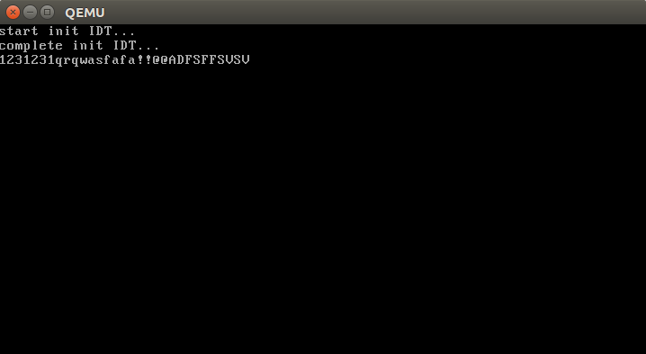

# 带你用纯汇编写操作系统体验代码

这个代码是小课《带你用纯汇编写OS》的配套代码的一部分，给大家体验中断用的
 
接下来我跟大家说说这个代码怎么用才能发挥它的潜力

我是子牙，一个很卷的硬核男人，聚焦做大家想学没地方学的课程：手写OS、手写JVM…
 
欢迎关注我的公众号：硬核子牙，巨多干货在其中……

### 如何体验

前提：你得有运行环境.如果你还没有,参考这篇文章搭建:https://mp.weixin.qq.com/s/SK78ddgZyz2MlcC24BTtgw

主要就是安装模拟器:bochs\qemu

### windows下体验

如果你想在windows下体验,参考这篇文章:https://mp.weixin.qq.com/s/gnx0eAbtkEtoRya-MQAf_Q

看下实际效果:

我实现的键盘驱动,输入数字\小写字母\大写字母\特殊字符,都可以